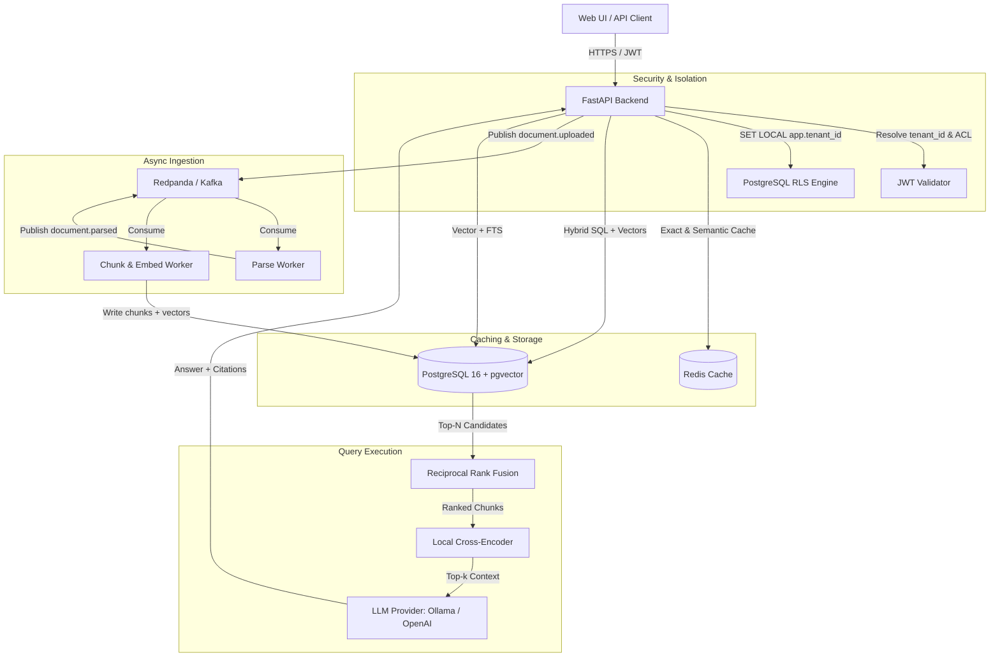
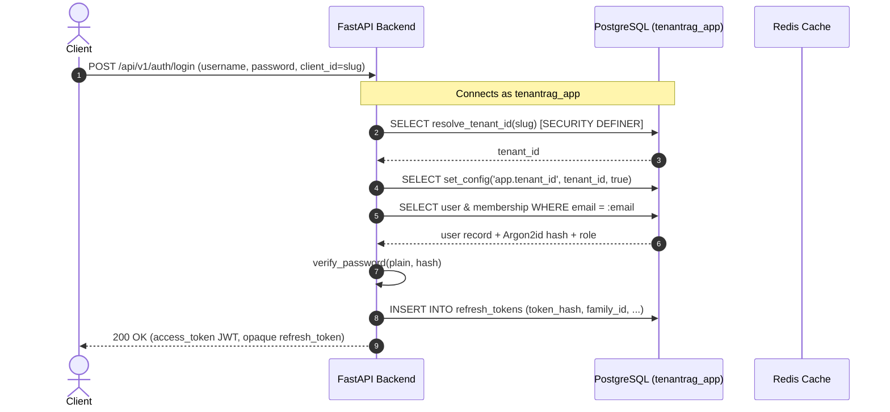
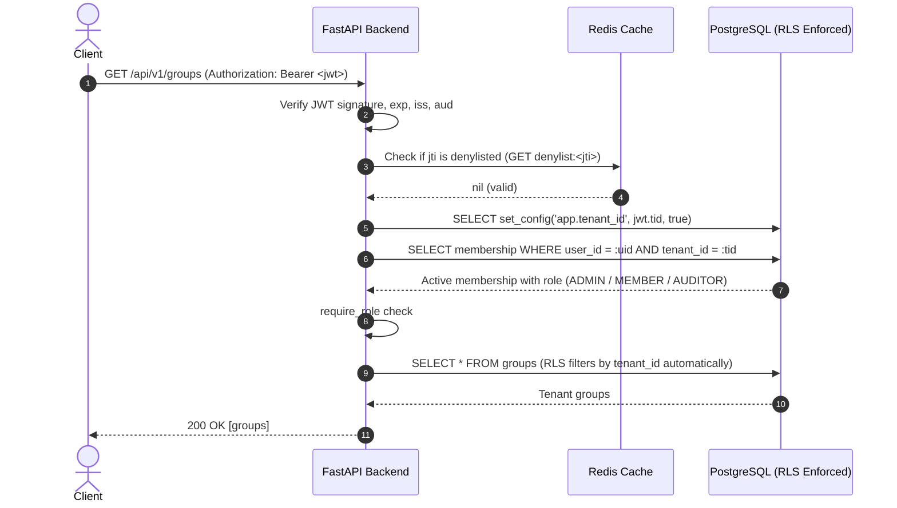

# TenantRAG Architecture

## Overview
TenantRAG is a production-style, multi-tenant Retrieval-Augmented Generation (RAG) platform featuring:
- Strict multi-tenant isolation via PostgreSQL Row-Level Security (RLS) and pre-ranking ACL SQL filters.
- Asynchronous event-driven document ingestion pipeline powered by Kafka / Redpanda.
- Hybrid search (pgvector cosine similarity + PostgreSQL full-text search) merged with Reciprocal Rank Fusion (RRF), followed by local cross-encoder reranking.
- Redis-based two-tier semantic cache (exact query match + vector similarity cache) partitioned by tenant and permission signature.
- Systematic evaluation suite measuring retrieval metrics (recall@k, MRR, nDCG@k) and LLM-as-a-judge generation metrics (faithfulness, answer relevancy, context precision).
- Per-tenant token and cost tracking for auditable usage accounting.

---

## System Component Diagram



---

## Services in Docker Compose

1. **`postgres` (`pgvector/pgvector:pg16`)**:
   - Stores tenant metadata, users, documents, chunks, embeddings (`vector(384)`), full-text search tokens (`tsvector`), query logs, and evaluation runs.
   - Enforces PostgreSQL Row-Level Security policies.
2. **`redis` (`redis:7-alpine`)**:
   - Fast key-value store for exact query caching, rate limiting sliding windows, and semantic vector similarity lookups.
3. **`kafka` (`docker.redpanda.com/redpandadata/redpanda:v24.1.2`)**:
   - Event broker orchestrating document processing stages with dead-letter queue (DLQ) support and at-least-once processing guarantees.
4. **`api` (`backend/Dockerfile`)**:
   - FastAPI REST API serving `/api/v1` routes: Auth, Documents, Query, Evaluation, Usage, and System Health.
5. **`worker` (`backend/Dockerfile`)**:
   - Background consumer daemons processing parsing, chunking, and embedding jobs asynchronously.
6. **`frontend` (Phase 7)**:
   - React + TypeScript + Vite single-page application with Recharts dashboards.

---

## Multi-Tenancy & Authentication (Phase 1)

### 1. Dual Role & Row-Level Security Architecture
- **Migrations & Administrative Tasks**: Conducted by the superuser role (`tenantrag`) possessing `SUPERUSER` and `BYPASSRLS`.
- **Runtime Application Queries**: Conducted by unprivileged role (`tenantrag_app`), strictly subject to PostgreSQL `FORCE ROW LEVEL SECURITY`.
- **Tenant Context Session Variable**: Every query runs inside a transaction after executing:
  ```sql
  SELECT set_config('app.tenant_id', :tenant_id, true);
  ```
  The third parameter `true` scopes the variable to the local transaction, eliminating cross-request connection pool leakage.

### 2. Authentication Flow Sequence



### 3. Authenticated Request & RBAC Verification Sequence



